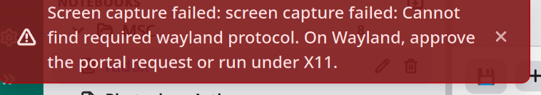

# LifeLogr Modifications-Idea

&nbsp;

- [ ] Use distinct colors for the Notes tab to improve visual identification,
- [ ] Allow pasted images to be resized in both notes and journals
- [ ] Move the floating microphone in the journal to be next to the speaker at the bottom
- [ ] Ensure data safety and security
- [ ] Fix sniper fail in Notes
- [ ] Notes should be draggable, droppable, and nestable
- [ ] Auto-title from first line
- [ ] Frequently screen goes blank, fix it
- [ ] when app closed, it takes some time to close

&nbsp;
